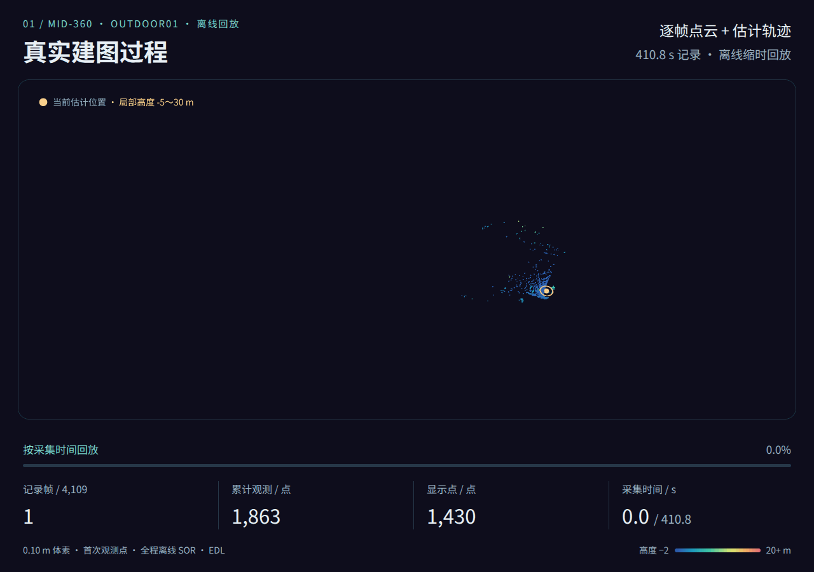
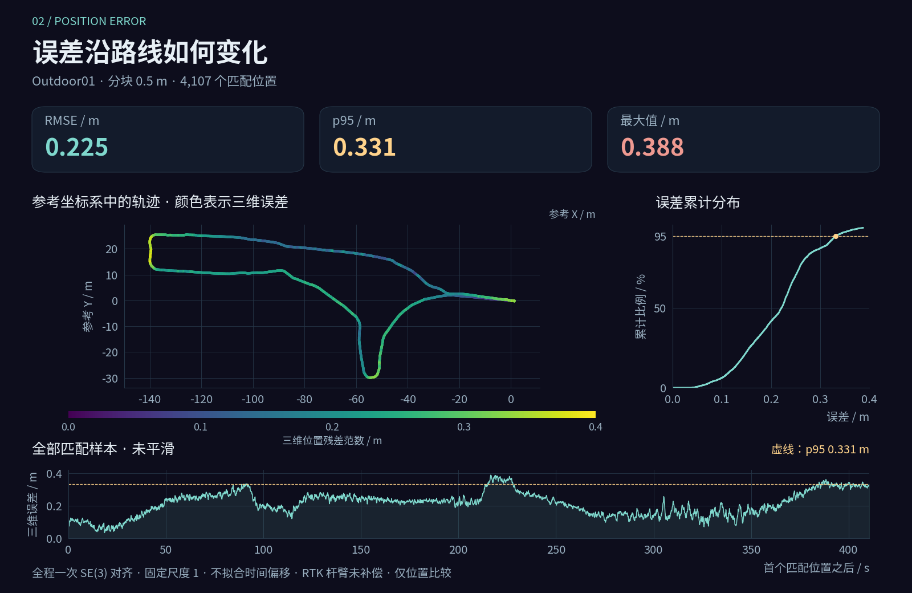
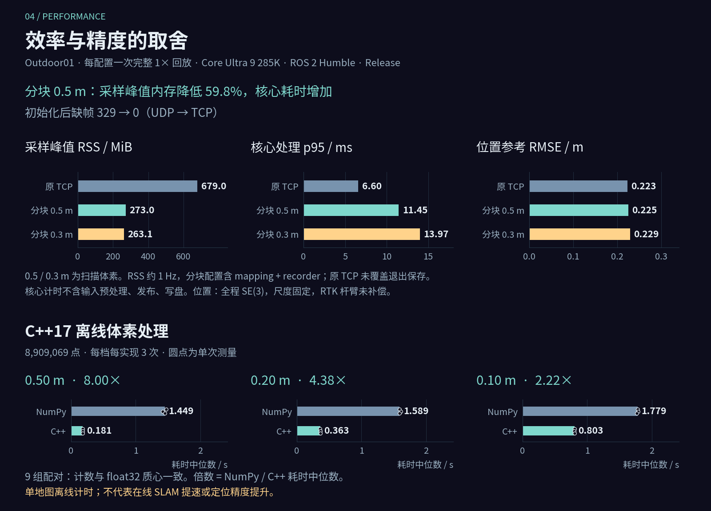
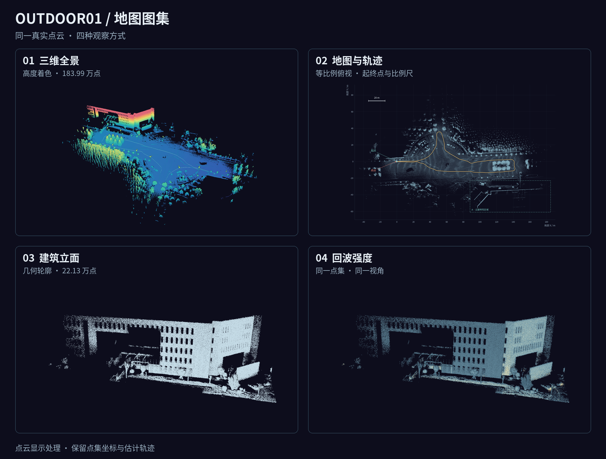
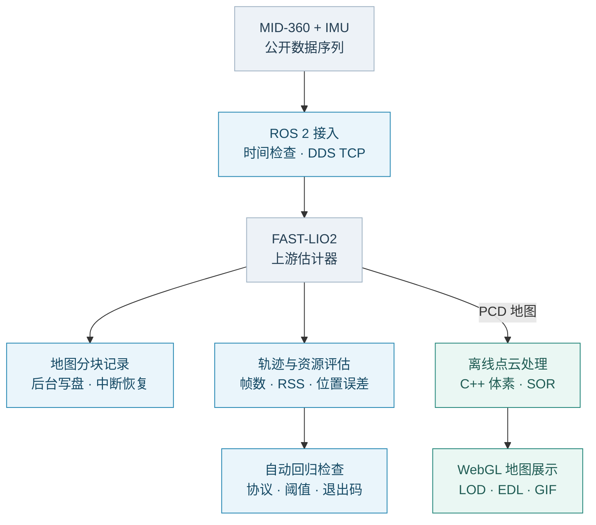
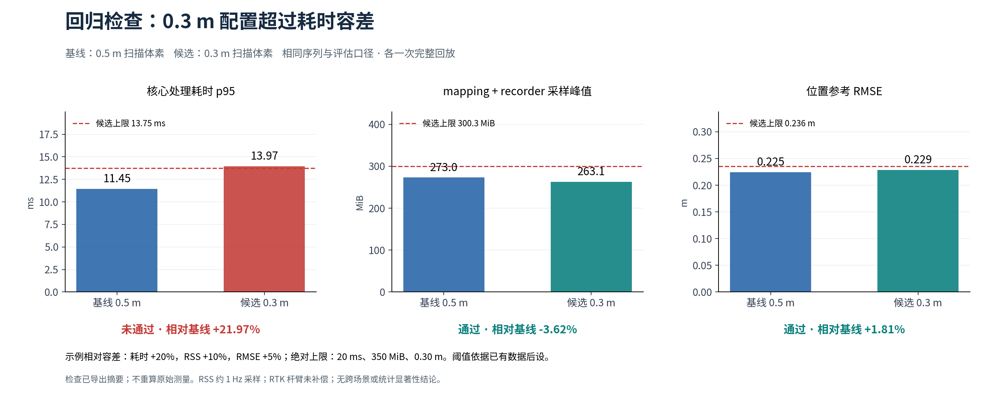

# FAST-Lio2-个人研究版

**MID-360 · FAST-LIO2 · ROS 2** — 移动机器人定位、建图与工程验证。

**[交互地图](https://AYANE225.github.io/FAST-Lio2-personal-research/viewer/)** · [实验数据](docs/homepage_showcase.md) · [工程成果](docs/career_evidence.md) · [复现](docs/reproduction.md)

## 建图过程

<a href="docs/homepage_showcase.md#建图回放">
  <picture>
    <source media="(prefers-reduced-motion: reduce) and (max-width: 640px)" srcset="figures/outdoor01_mapping_poster_mobile.png">
    <source media="(prefers-reduced-motion: reduce)" srcset="figures/outdoor01_mapping_poster.png">
    <source media="(max-width: 640px)" srcset="figures/outdoor01_mapping_mobile.gif">
    
  </picture>
</a>

**410.8 秒记录 → 14 秒回放** · 0.10 m 体素保留首次观测点，再做全程离线 SOR；仅用于显示。

[回放 MP4](figures/outdoor01_mapping.mp4) · [360° 高清旋转](figures/outdoor01_rotation.gif) · [静态全景](figures/outdoor01_map_overview.png)

## 实测结果

<a href="docs/homepage_showcase.md#位置误差">
  <picture>
    <source media="(max-width: 640px)" srcset="figures/outdoor01_position_error_mobile.png">
    
  </picture>
</a>

<a href="docs/homepage_showcase.md#中断恢复">
  <picture>
    <source media="(max-width: 640px)" srcset="figures/outdoor01_recovery_mobile.png">
    
  </picture>
</a>

<a href="docs/engineering_results.md">
  <picture>
    <source media="(max-width: 640px)" srcset="figures/outdoor01_performance_mobile.png">
    
  </picture>
</a>

## 高清图集

<a href="docs/map_gallery.md">
  <picture>
    <source media="(max-width: 640px)" srcset="figures/outdoor01_gallery_mobile.png">
    
  </picture>
</a>

[全景](figures/outdoor01_map_overview.png) · [轨迹俯视](figures/outdoor01_map_route.png) · [立面对照](figures/outdoor01_map_facade.png) · [旋转 MP4](figures/outdoor01_rotation.mp4)

工程流程与能力对应

[岗位能力对应](docs/job_requirements.md) · [代码与实测](docs/career_evidence.md) · [记录器设计](docs/map_recording.md)

处理对照、回归结果与复现资料

**同一区域、视角、点大小与色标。显示处理不参与定位估计。**

**保留真实失败结果：0.3 m 配置超过示例耗时容差。**

[全量曲线](docs/engineering_results.md) · [首页图表与实验口径](docs/homepage_showcase.md) · [配置对比原图](figures/readme_results.svg) · [体素计时原图](figures/readme_voxel.svg) · [旋转动画生成](docs/map_rotation.md) · [复现步骤](docs/reproduction.md)

Outdoor01 单序列桌面回放；实际移动机器人部署仍需现场验证。算法：[FAST_LIO](https://github.com/hku-mars/FAST_LIO) · 数据：[M3DGR](https://github.com/sjtuyinjie/M3DGR) · [来源与许可](NOTICE.md)
