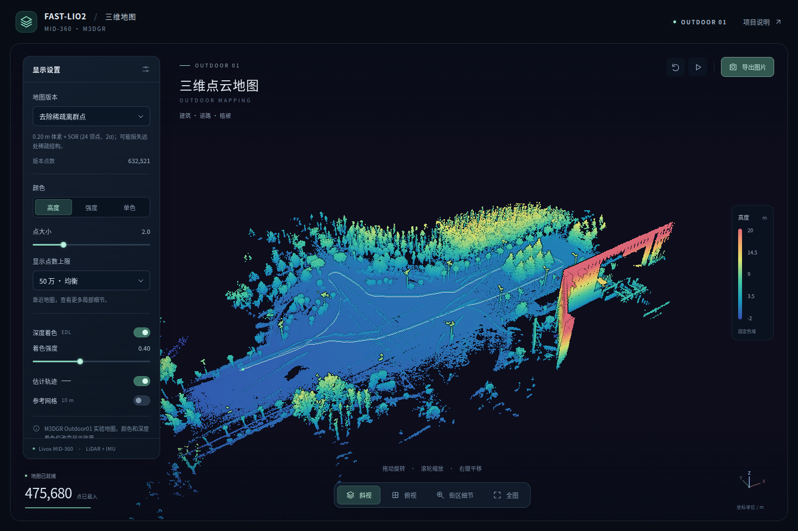

# FAST-Lio2-个人研究版

围绕 **FAST-LIO2 / MID-360 移动机器人**开展的工程研究：ROS 2 数据接入与传输诊断、地图分块记录、资源与位置误差评估、真实点云的交互展示。实验使用 **M3DGR Outdoor01 公开序列**，当前成果是桌面完整回放与自动化验证。

**[打开三维地图](https://AYANE225.github.io/FAST-Lio2-personal-research/viewer/)** · [工程实验结果](docs/engineering_results.md) · [复现说明](docs/reproduction.md) · [方法与官方资料](docs/engineering_references.md)

[](https://AYANE225.github.io/FAST-Lio2-personal-research/viewer/)

## 已验证的改进与取舍

关闭上游历史地图、路径及内部 PCD 累积，改用独立进程分块记录完整已配准扫描。在这次 Outdoor01 回放中，**mapping + recorder 的同时采样峰值 RSS 从 679.0 MiB 降至 273.0 MiB，约下降 60%**；4,109 帧、8,909,069 点全部落盘。收益来自缓存与记录方式调整，核心处理耗时有所增加。

| 指标 | 原 TCP 基线 | 分块记录 · 0.5 m | 分块记录 · 0.3 m |
|---|---:|---:|---:|
| 初始化后输出 / 应输出帧 | 4,109 / 4,109 | 4,109 / 4,109 | 4,109 / 4,109 |
| mapping 采样峰值 RSS | 679.0 MiB | 210.5 MiB | 200.4 MiB |
| mapping + recorder 同时采样峰值 RSS | 679.0 MiB¹ | **273.0 MiB** | 263.1 MiB |
| 核心处理耗时 p95 | 6.60 ms | 11.45 ms | 13.97 ms |
| 位置参考 RMSE | 0.223 m | 0.225 m | 0.229 m |

¹ 原基线没有独立 recorder。0.5 / 0.3 m 指估计器的扫描体素，地图体素均为 0.5 m；网页显示体素另行配置。测试平台为 Intel Core Ultra 9 285K、ROS 2 Humble、Release 构建，各配置一轮完整 1× 回放。RSS 约 1 Hz 采样；旧基线未覆盖退出保存，新记录覆盖受控退出。核心计时不含输入预处理、发布与写盘。

**保留 0.5 m 工程配置。** 0.3 m 在本轮更慢，也没有显示位置精度收益。位置参考采用全程一次固定尺度 SE(3) 对齐，未拟合时间偏移、未补偿 RTK 杆臂，GT 姿态为占位值。这些结果不支持跨场景精度提升或实机硬实时结论。


## 工程能力与证据

| 工作 | 实现与可检查证据 |
|---|---|
| 传感器与 ROS 2 集成 | Livox CustomMsg / IMU 时间字段校验、MID-360 配置、独立 domain 与进程管理；[回放工具](scripts/replay_outdoor01.py) |
| 传输问题定位 | 原 UDP 回放初始化后缺少 329 帧，套接字记录 6,336 个丢弃数据报；只切换本机 DDS TCP 后缺帧为 0；[原始报告](docs/report.md) |
| 地图记录与故障处理 | 有界回调队列、后台解析写盘、完整帧分块、原子索引、文件和目录同步、错误计数、中断恢复；[记录器说明](docs/map_recording.md) |
| 性能与精度分析 | 输入台账、算法计时、位姿和记录帧逐项核对；同时统计 mapping 与 recorder；[结果与边界](docs/engineering_results.md) |
| 点云处理与前端展示 | 体素质心、SOR、受约束局部平面投影、空间分块 LOD、点数预算、深度纹理 EDL、PNG 导出；[处理工具](scripts/process_map.py) / [查看器](docs/viewer) |
| 测试与复现 | 队列过载、写入失败、异常终止恢复、浮点位移上限、浏览器上下文恢复、发布数据 SHA256；[测试](tests) / [CI](.github/workflows/verify.yml) |

## 地图外观处理

全图保留 0.50 / 0.20 / 0.10 m 三档体素；网页默认显示 0.20 m + SOR，并可切回未做 SOR 的体素版本。支持高度、强度、单色、EDL 深度着色、估计轨迹和预设视角。桌面默认最多显示 50 万点，手机 20 万点，按空间块和视角选择分辨率。

下图使用同一个局部区域、相机、点大小和色标，比较原始点、0.05 m 体素、SOR、局部平面投影。局部投影的位移 p95 为 14.75 mm，最大 30.00 mm；这是受约束的单次投影，未实现完整 MLS。**这些显示处理不参与定位估计，也不能作为定位精度提高的证据。**


## 快速复现

Python 3.11；以下命令只使用仓库内公开结果，无需 ROS、原始 bag 或完整 PCD：

```bash
sudo apt-get install fonts-noto-cjk
python3.11 -m venv .venv
.venv/bin/pip install -r requirements.txt
.venv/bin/python scripts/verify_artifacts.py
.venv/bin/python scripts/plot_engineering.py --output-dir output/figures
.venv/bin/python scripts/plot_evaluation.py --output-dir output/baseline-figures
```

本地打开三维地图：

```bash
python3 -m http.server 8767 --bind 127.0.0.1 --directory docs
# 浏览器访问 http://127.0.0.1:8767/viewer/
```

完整回放、离线点云处理、ROS 测试和浏览器验收命令见 [复现说明](docs/reproduction.md)。原始 bag、完整 PCD、完整分块记录留在本地；仓库提供轻量派生点云、逐帧结果、图表及校验清单。

## 下一步

优先补齐时间同步、外参及 RTK 杆臂，完善端到端延迟测量；在目标机器人计算机上做 30–60 分钟运行与重启测试，并加入室内走廊、动态行人和室内外切换序列。随后以多轮结果评估滤波参数、地图范围和回环约束。当前 ikd-tree 仍随有效地图变化，分块记录不等于整个 SLAM 系统无限时长恒定内存。

## 来源与许可

算法来自 [hku-mars/FAST_LIO](https://github.com/hku-mars/FAST_LIO)，数据来自 [sjtuyinjie/M3DGR](https://github.com/sjtuyinjie/M3DGR)，三维渲染使用 [Three.js](https://threejs.org/)。本仓库贡献为集成、工程工具、实验诊断和展示；未提出新的 FAST-LIO2 算法。原创独立工具采用 MIT，既有上游补丁保留 GPL-2.0，数据出处与第三方许可见 [NOTICE](NOTICE.md)。
