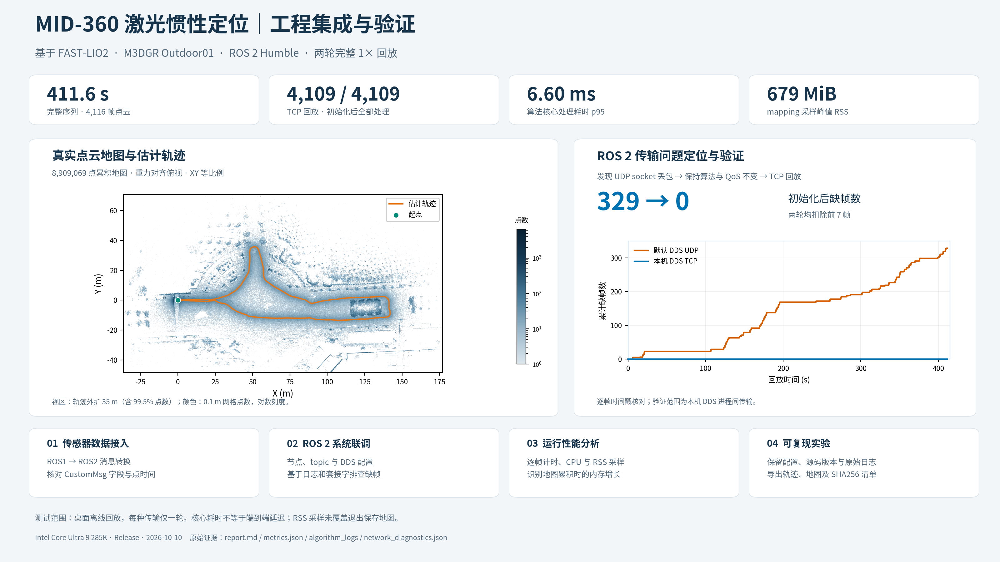
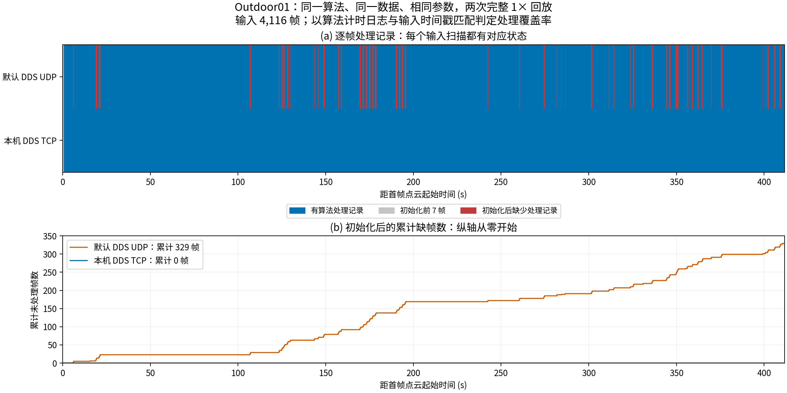

# FAST-Lio2-个人研究版

围绕 **FAST-LIO2 / MID-360** 开展的个人研究与工程验证。目前基于 ROS 2 Humble 和 M3DGR Outdoor01 建立了可复现的定位建图基线。重点展示传感器数据接入、DDS 传输问题排查、逐帧完整性检查、性能分析和可复现评估。

Reproducible MID-360 LiDAR–inertial odometry evaluation with ROS 2 transport diagnostics and measured runtime results.

## 实测结果

同一数据、同一算法及 QoS 参数，分别使用默认 DDS UDP 和本机 DDS TCP 完整回放一次。

| 指标 | 默认 DDS UDP | 本机 DDS TCP |
|---|---:|---:|
| 序列时长 | 411.57 s | 411.57 s |
| 输入点云 / IMU | 4,116 / 82,312 | 4,116 / 82,312 |
| 输出位姿数 | 3,780 | **4,109** |
| 初始化后缺帧数 | 329 | **0** |
| 核心处理耗时 p95 | 6.81 ms | **6.60 ms** |
| 核心处理耗时 p99 | 7.68 ms | 11.40 ms |
| mapping 采样峰值 RSS | 652.1 MiB | 679.0 MiB |

测试平台为 Intel Core Ultra 9 285K，Release 构建。前 7 帧属于初始化阶段；核心耗时不等于端到端延迟，RSS 采样未覆盖退出保存地图。每种传输仅一轮，耗时差异不构成算法提速结论。

## 工程问题与证据

第一轮算法缺少 329 帧处理记录。运行期间，mapping 的 UDP 接收套接字记录了 6,336 个丢弃数据报。保持算法、滤波参数和订阅队列深度不变，切换本机 DDS TCP 后，初始化后的 4,109 帧全部产生处理记录。

完整证据见 [实验报告](docs/report.md)、[UDP 套接字记录](data/outdoor01/udp/network_diagnostics.json)、[TCP 指标](data/outdoor01/tcp/metrics.json) 和 [UDP 指标](data/outdoor01/udp/metrics.json)。数据报数与点云帧数不是同一个量；该结果验证的是本机 ROS 2 进程间传输。

## 图表与复现

[耗时、CPU、RSS](figures/runtime.png) · [位置误差参考评估](figures/accuracy.png) · [完整地图投影](figures/map_projection.png) · [SVG 原图](figures)

Python 3.11，Ubuntu 22.04 或更新版本：

    sudo apt-get install fonts-noto-cjk
    python3.11 -m venv .venv
    .venv/bin/pip install -r requirements.txt
    .venv/bin/python scripts/plot_evaluation.py --output-dir output/figures

该命令校验输入 SHA256，核对逐帧覆盖率与耗时，生成全部五张 PNG / SVG 图和新的校验清单。使用仓库内已保存的地图网格，不需要 ROS、原始 bag 或完整 PCD。详见 [数据与复现说明](docs/reproduction.md)。

## 评估范围

- 基于 FAST-LIO2 的集成验证；本仓库不提出新的 SLAM 算法。测试时已有的 C++17 构建及地图保存补丁保存在 [patches](patches/fast-lio2-local.patch)。
- 位置参考评估为 4,107 个匹配位姿，经一次固定尺度 SE(3) 对齐后 RMSE 为 0.223 m。未拟合时间偏移，未补偿 RTK 杆臂；GT 姿态为占位值，因此不评估姿态误差。
- RSS 随累积地图增长；下一步需要验证地图保存与历史缓存策略，以及目标机器人上的长期运行。
- 当前为桌面离线回放；机器人实机部署、室内退化场景和多轮稳定性测试尚待补充。

## 后续研究：效率和精度

以下为待开展的研究，不代表已取得改进结果。保留当前回放作为基线，每次只改变一个因素，再比较完整处理率、误差、耗时与资源消耗。

| 方向 | 优先工作 | 评价方式 |
|---|---|---|
| 运行效率 | 分开测量预处理、IMU 去畸变、滤波更新、地图插入和发布；检查点云与轨迹历史缓存 | 端到端延迟及各阶段 p50 / p95 / p99、CPU、RSS、缺帧率 |
| 长期运行 | 比较地图分段保存与缓存上限，在目标机器人计算机上进行 30–60 分钟测试 | 内存增长趋势、采样峰值、输出连续性、重启恢复 |
| 定位精度 | 确认时间同步、外参及 RTK 天线杆臂，再评估滤波噪声、点云过滤与体素尺寸 | 固定评估协议下的位置 APE / RPE，连同失败率与耗时报告 |
| 场景覆盖 | 补充室内走廊、动态行人、室内外切换；对候选改动做多轮复测 | 同一硬件与配置下比较多个序列，保留逐轮结果 |

先完善计时与精度评估依据，再开展参数和代码优化。不能仅凭单次耗时降低或地图外观变化判断改进有效。

## 来源

算法：[hku-mars/FAST_LIO](https://github.com/hku-mars/FAST_LIO)，[实验源码版本](data/outdoor01/source_version.json)。

数据：[M3DGR](https://github.com/sjtuyinjie/M3DGR) / [项目主页](https://sjtuyinjie.github.io/M3DGR-website/)。完整数据集从官方来源获取，本仓库保存本次实验的派生结果。上游代码及补丁的许可说明见 [NOTICE.md](NOTICE.md)。
