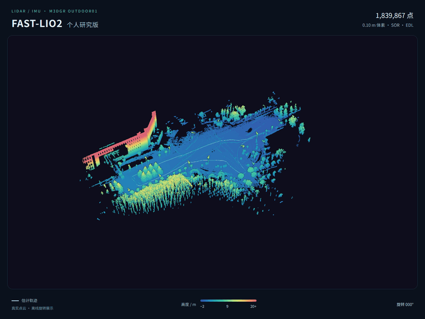
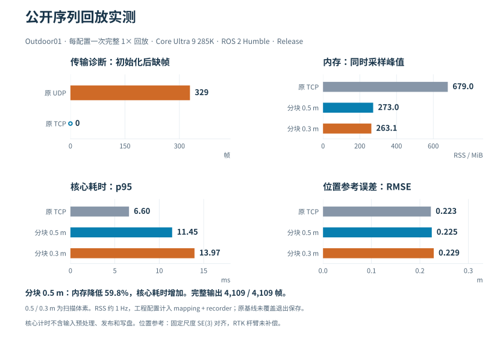
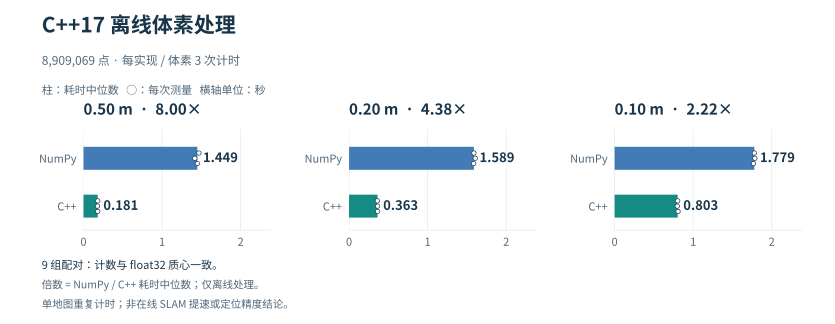
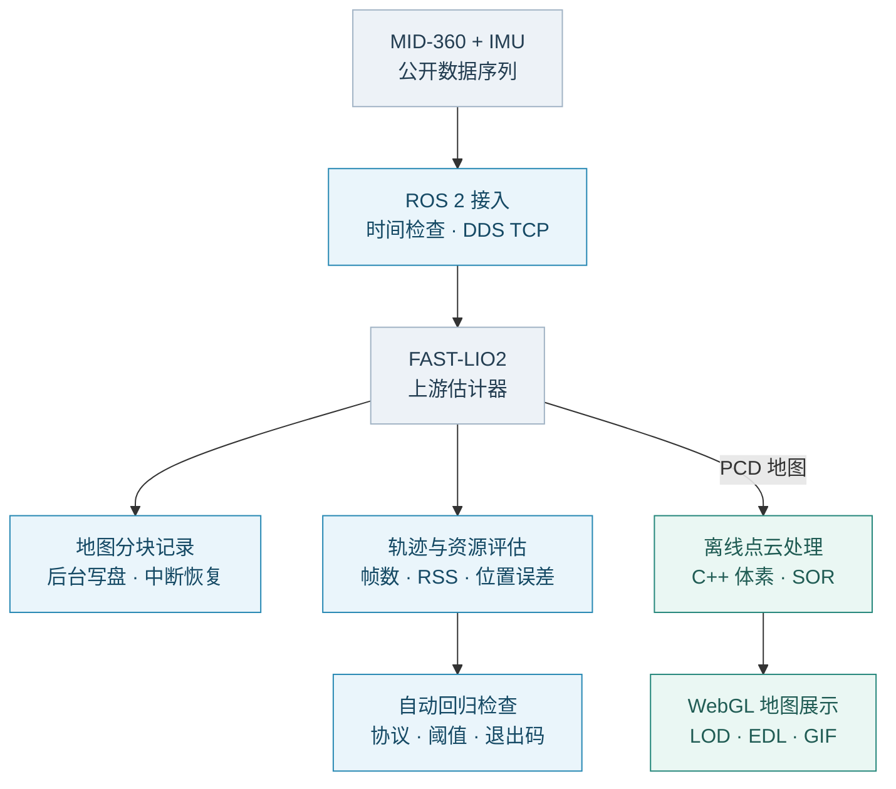

# FAST-Lio2-个人研究版

**MID-360 · FAST-LIO2 · ROS 2** — 移动机器人定位与建图工程研究，使用 Outdoor01 公开序列做桌面回放验证。

**[打开交互地图](https://AYANE225.github.io/FAST-Lio2-personal-research/viewer/)** · [复现](docs/reproduction.md) · [代码与实测](docs/career_evidence.md) · 

**183.99 万点 · 0.10 m 体素 · 16 秒循环**　[高清 GIF](figures/outdoor01_rotation.gif) · [MP4](figures/outdoor01_rotation.mp4)

## 实测结果

<a href="docs/engineering_results.md">
  <picture>
    <source media="(max-width: 640px)" srcset="figures/readme_results_mobile.svg">
    
  </picture>
</a>

<a href="docs/career_evidence.md">
  <picture>
    <source media="(max-width: 640px)" srcset="figures/readme_voxel_mobile.svg">
    
  </picture>
</a>

## 工程流程

展开：点云处理对照、回归检查与详细资料

**同一区域、视角、点大小与色标。显示处理不参与定位估计。**

**保留真实失败结果：0.3 m 配置超过示例耗时容差。**

[全量曲线与实验口径](docs/engineering_results.md) · [岗位能力对应](docs/job_requirements.md) · [记录器](docs/map_recording.md) · [动画生成](docs/map_rotation.md) · [复现步骤](docs/reproduction.md)

算法：[FAST_LIO](https://github.com/hku-mars/FAST_LIO) · 数据：[M3DGR](https://github.com/sjtuyinjie/M3DGR) · 渲染：[Three.js](https://threejs.org/) · [来源与许可](NOTICE.md)
