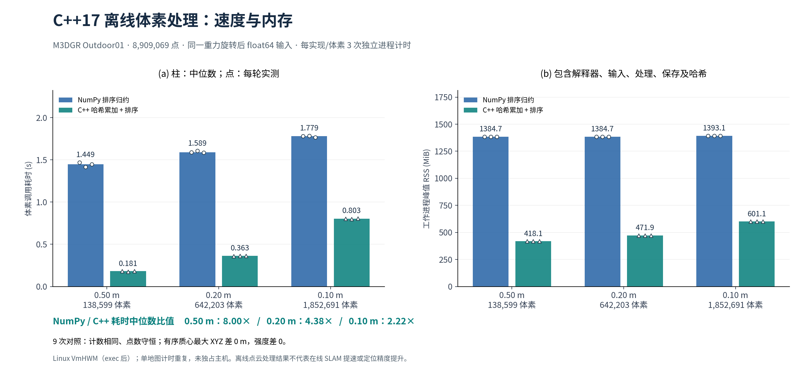

# 面向机器人软件岗位的项目证据

本轮补齐 **C++17 点云处理、可复现性能实验和自动回归检查**。这些成果对应官方岗位样本中的 C++、ROS、性能测量、日志复现和自动化测试要求，详见 [招聘要求与来源](job_requirements.md)。项目使用公开 MID-360 数据进行桌面验证；学历、工作年限、实机部署和定位算法研究能力需要另外提供证据。

[三维地图](https://ayane225.github.io/FAST-Lio2-personal-research/viewer/) · [完整数据与测试记录](../data/career/) · [C++ 源码](../cpp/voxel_centroids.cpp) · [回归检查](../scripts/check_regression.py)

## C++17：实现、数值与性能

在同一 Outdoor01 全图的 **8,909,069 点**上，比较原 NumPy 排序归约与新增 C++ 哈希累加、按整数体素键排序。两者均使用零原点 `floor(XYZ / size)`、double 累加，输出 float32 XYZI 质心和 int64 占据计数。C++ 通过 C ABI 接入 Python，默认离线处理仍使用 NumPy。



| 显示体素 | 输出体素数 | NumPy 中位耗时 | C++ 中位耗时 | NumPy / C++ | NumPy / C++ 峰值 RSS 中位数 |
|---|---:|---:|---:|---:|---:|
| 0.50 m | 138,599 | 1.449 s | 0.181 s | 8.00× | 1384.7 / 418.1 MiB |
| 0.20 m | 642,203 | 1.589 s | 0.363 s | 4.38× | 1384.7 / 471.9 MiB |
| 0.10 m | 1,852,691 | 1.779 s | 0.803 s | 2.22× | 1393.1 / 601.1 MiB |

每实现、每体素三次独立进程计时，共 18 次；两种实现按轮次交替先后顺序。九次配对比较均满足点数守恒、输出计数相同，本次有序 float32 质心的最大 XYZ 差和强度差均为 0。边界单测另外覆盖负坐标、恰好位于边界和 `nextafter` 邻近值；没有通过舍入后的质心反推整数分箱键。随机数据与其他机器仍应按明确的浮点容差核验，不能把本次相等泛化成所有输入逐位相等。

实验平台为 Intel Core Ultra 9 285K、GNU C++ 13.3.0、CMake Release `-O3 -DNDEBUG`，未启用 fast-math；Python 3.11.16、NumPy 1.26.4。数据结构也发生了变化：原实现排序所有 N 个点，新增实现先哈希累加，再排序 V 个占据体素。收益来自这两个具体实现的差异，不能归结为“C++ 语言本身快 8 倍”。哈希表预留输入点数对应的容量，以减少扩容，仍有内存开销。

计时覆盖公开体素函数调用，包括输入检查、原生包装及复制；NPY 读取、保存和父进程数值对照另计。RSS 是 Linux `/proc/self/status` 的 `VmHWM`，覆盖工作进程 exec 后的解释器、依赖、输入、处理、保存及哈希，**不是算法独占内存**。原始 `ru_maxrss` 也逐轮保留：最小复现实验证明它会继承父进程 exec 前的内存峰值，已添加测试防止用该值高估小工作进程内存。未做 CPU 绑定或独占主机，三次重复只反映同一地图上的计时变化。

源地图只应用既有重力旋转，未依据参考轨迹调整。完整 [逐轮结果](../data/career/voxel_benchmark.json) 包含输入、变换、源码及共享库 SHA256、构建参数、CPU、每轮读取／计算／保存耗时和数值比较。**这是离线地图处理性能，不是在线 FAST-LIO2 提速或定位精度提升。**

实现可讲解的部分：

- [C ABI 与所有权](../cpp/voxel_centroids.h)：异常留在库内，返回明确状态码；数组由同一库分配、释放，失败不暴露半成品。
- [C++ 实现](../cpp/voxel_centroids.cpp)：`unordered_map`、double 累加、确定的整数键排序、`unique_ptr` 异常清理、整数与浮点范围检查。
- [Python 包装](../scripts/native_voxel.py)：ctypes 类型声明、保持 double 输入精度、保证连续且对齐的输入内存、复制后 `finally` 释放，显式请求 C++ 时不自动回退。
- [测试](../tests/test_native_voxel.py) 与 [原生检查](../cpp/test_voxel_centroids.cpp)：48 项 Python 用例和 8 组 C++ 行为检查；Release 测试不依赖会被 `NDEBUG` 关闭的断言，另执行 ASan／UBSan 和泄漏检查。字节偏移导致的非对齐 NumPy 输入另通过 UBSan 库验证，覆盖普通 x86 数值测试无法可靠暴露的未定义行为。

## 回归检查：把失败结果保留下来

[check_regression.py](../scripts/check_regression.py) 读取既有 `metrics.json`、`run_summary.json` 和 [示例容差](../configs/regression_limits.json)。先验证数值类型、有限性及内部计数，再比较序列、输入时间台账哈希、回放速率、DDS、计时与资源定义、参考哈希、匹配和对齐规则。协议不同便停止性能判定。

可比时检查进程正常退出、初始化后缺帧、记录错误、未排空队列、占据队列容量、RSS、核心 p95 和位置参考 RMSE。报告逐项给出 `actual / limit / status`，记录读入文件的原始字节 SHA256；拒绝重复 JSON 键、未知容差键、NaN、Inf、布尔值冒充数字和缺字段。

摘要还须满足已有导出器的约束：输入时间戳匹配差不超过 10 μs、四元数范数误差不超过 `1e-7`；联合资源峰值与按样本数加权的均值须与各进程统计一致；分块数及容量必须容纳已写入帧和点。录制耗时、设置等已声明字段单独检查类型和重复值。无法从摘要证明原始日志完整，未知扩展字段也不自动获得语义验证。

均值与最小／最大值的一致性检查允许 `1e-12` 相对舍入误差，避免正常常数样本被浮点求和误拒绝。性能验收仍严格比较上限；高于阈值一个浮点步长的测试仍判失败。


| 输入 | 实际结果 | 意义 |
|---|---|---|
| recording 与自身 | [通过，退出码 0](../data/career/regression_self.json) | 完整输入与示例容差的正常路径 |
| recording 与 surf03 | [未通过，退出码 1](../data/career/regression_surf03.json) | 0.3 m 配置 p95 为 13.97054 ms，超过 13.74531 ms 的相对上限 |
| 缺字段、坏计数、NaN、协议不一致等测试反例 | [拒绝，退出码 2](../tests/test_check_regression.py) | 数据无效或不可比时不给出性能通过结论 |

示例相对上限为耗时 +20%、采样 RSS +10%、位置 RMSE +5%；绝对上限为 20 ms、350 MiB、0.30 m。它们是看过既有结果后给出的工程示例，**不是行业标准、预注册阈值或显著性检验**。没有为让 0.3 m 通过而放宽耗时容差：本次 p95 增加 21.97%，RMSE 增加 1.81%，仍保留 0.5 m 配置。

工具只核对导出的摘要，不能代替 [原始台账与参考评估](../scripts/evaluate_engineering.py)，也不能验证摘要未记录的硬件或系统负载。现有位置参考采用一次全程 SE(3) 对齐、固定尺度和时间偏移；RTK 杆臂未补偿。原 TCP 旧摘要格式没有自动迁移到新检查器。

## 复现与面试讲解

本轮本地验证通过 199 项 Python 测试（含 ROS 消息测试）、20 项前端测试、8 组 C++ 行为检查，以及 ASan／UBSan／泄漏检查；非对齐 NumPy 输入还单独加载 UBSan 库验证。[验证记录](../data/career/validation.json) 保留各项日志、日志完成时间和源码哈希，线上结果以对应提交的 GitHub Actions 为准。

Python 3.11 环境先安装 `requirements-dev.txt`，C++ 部分仅依赖标准库、CMake 和编译器：

```bash
cmake -S . -B output/native-build -DCMAKE_BUILD_TYPE=Release
cmake --build output/native-build --parallel 2
ctest --test-dir output/native-build --output-on-failure
PYTEST_DISABLE_PLUGIN_AUTOLOAD=1 python -m pytest -q

python scripts/check_regression.py \
  --baseline-dir data/outdoor01/recording \
  --candidate-dir data/outdoor01/surf03 \
  --limits configs/regression_limits.json --output output/regression.json
# 预期退出码 1：真实候选超过示例耗时容差。

python scripts/plot_career_evidence.py --output-dir output/career_figures
```

完整地图基准需要既有 TCP 基线导出的 `map.pcd`，SHA256 为 `a1647137abfbc2e47f209a88c42900b1d856013373dbb5550da5cfab410ae557`。它不随仓库分发，不需要再次下载 bag 才能复核已发布摘要、源码和图表：

```bash
python scripts/benchmark_voxel.py --map-pcd /path/to/map.pcd \
  --output-dir output/voxel_benchmark --repeats 3 --voxel-sizes .5 .2 .1

python scripts/process_map.py --map-pcd /path/to/map.pcd \
  --voxel-backend cpp --output-dir output/map_cpp \
  --viewer-data output/viewer_cpp
```

基准必须使用新输出目录，避免把不同执行的数据混在一起。完整输入 NPY 和各轮输出留在本地，公开仓库只保留结果及哈希。图表可导出 PNG／SVG，用于求职附件时应保留标题、单位和底部实验范围。

面试时可沿三个问题展开：为什么把全点排序改成哈希累加，收益为何随体素变细下降；如何保证跨语言内存释放与浮点分箱；为什么数据缺失、口径变化和性能退步要用不同退出状态。已有地图记录、DDS 故障排查和 ROS 2 接入可以接着讲，见 [工程结果](engineering_results.md)。

下一阶段优先补充时间同步、外参及 RTK 杆臂、端到端延迟和目标计算机 30–60 分钟运行／重启测试，再加入室内走廊、动态行人和室内外切换序列。回环、重定位、轮速／GNSS 融合和现场部署仍为待验证能力，不能用离线滤波或网页外观代替。
