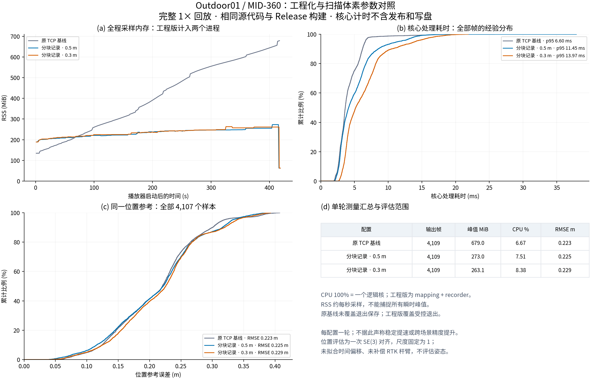
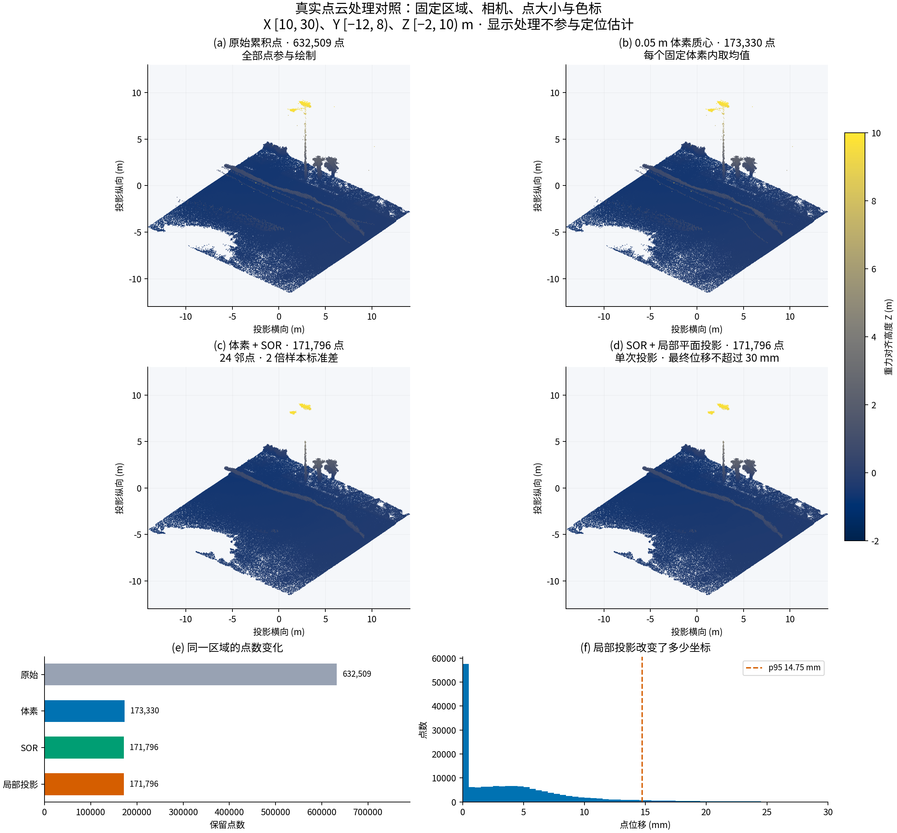

# Outdoor01 工程优化与点云展示结果

本轮验证地图记录方式对资源占用的影响，并对扫描体素做一次单因素试验。采用独立分块记录后，mapping + recorder 同时采样峰值 RSS 下降约 60%；0.3 m 扫描体素没有显示位置精度收益。因此保留 [0.5 m 配置](../configs/mid360_recording.yaml)，将 [0.3 m 配置](../configs/mid360_surf03.yaml) 作为已测候选留档。

## 实验条件与配置

M3DGR Outdoor01，Livox MID-360 + IMU，完整 1× 回放 411.57 s。输入点云 4,116 帧、IMU 82,312 条，前 7 帧为初始化阶段。Intel Core Ultra 9 285K、24 个逻辑核，ROS 2 Humble、Cyclone DDS 0.10.5，本机 TCP 传输。三个结果使用同一套 FAST_LIO 源文件与既有 C++17 / 地图保存补丁，Release 构建。编译产物为 `MP_PROC_NUM=1`、未定义 `MP_EN`；这不是强制所有进程只用一个 CPU。

| 项目 | 原 TCP 基线 | 分块记录 · 0.5 m | 分块记录 · 0.3 m |
|---|---|---|---|
| 扫描体素 `filter_size_surf` | 0.5 m | 0.5 m | 0.3 m |
| 地图体素 `filter_size_map` | 0.5 m | 0.5 m | 0.5 m |
| 历史 map / path 与内部 PCD 累积 | 原基线设置 | 关闭 | 关闭 |
| 完整已配准扫描发布 | 原基线设置 | 开启 | 开启 |
| 独立记录器 | 无 | 有界队列 32、分块写盘 | 同左 |
| 定位算法源码 | 相同 | 相同 | 相同 |

记录器用后台线程解析 `PointCloud2`，按完整帧写入块；块、索引及最终清单同步到文件系统。地图体素与离线显示体素属于不同处理阶段，不能混用参数含义。环境与源码核对见 [engineering_environment.json](../data/outdoor01/engineering_environment.json) 和各轮 `run_summary.json`。

## 完整回放结果

| 指标 | 原 TCP 基线 | 分块记录 · 0.5 m | 分块记录 · 0.3 m |
|---|---:|---:|---:|
| 输出位姿 / 处理帧 | 4,109 | 4,109 | 4,109 |
| 初始化后缺帧 | 0 | 0 | 0 |
| 保存点数 | 8,909,069 | 8,909,069 | 8,909,069 |
| 核心平均耗时 (ms) | 4.141 | 5.102 | 6.309 |
| 核心 p95 (ms) | 6.595 | 11.454 | 13.971 |
| 核心 p99 (ms) | 11.398 | 14.665 | 18.136 |
| 核心最大耗时 (ms) | 25.776 | 37.924 | 21.879 |
| mapping 采样峰值 RSS (MiB) | 679.035 | 210.504 | 200.426 |
| recorder 采样峰值 RSS (MiB) | — | 62.594 | 62.660 |
| 同时采样总 RSS 峰值 (MiB) | 679.035 | **272.957** | 263.078 |
| 总 CPU 均值 (%) | 6.670 | 7.513 | 8.383 |
| 位置参考 RMSE (m) | 0.222644 | 0.224517 | 0.228588 |
| 写入队列高水位 / 容量 | — | 16 / 32 | 11 / 32 |
| 持久化块数 | — | 140 | 154 |
| 记录器丢弃 / 失败 / 待写帧 | — | 0 / 0 / 0 | 0 / 0 / 0 |

新记录逐帧的点数与算法计时日志一致，时间戳与输出位姿一致。完整性还核对了输入台账中初始化后的全部 4,109 帧，避免仅比较两个可能同时漏帧的输出。每个保存块都有内容哈希、完整帧偏移与整数时间戳；结束后重新读取本地块验证，再导出公开台账。

公开证据：[原 TCP](../data/outdoor01/tcp/metrics.json)、[0.5 m](../data/outdoor01/recording/metrics.json)、[0.3 m](../data/outdoor01/surf03/metrics.json)。各目录提供计时、资源采样、轨迹、位置误差数组和记录清单；完整块留在本地。

## 如何理解结果

**内存收益明确来自本轮记录与缓存配置。** 总 RSS 使用同一采样时刻的 mapping + recorder 之和，未把两个分别出现的峰值相加。CPU 100% 表示一个逻辑核。RSS 约 1 Hz 采样，可能漏掉短时峰值；原基线只覆盖运行期间，新结果覆盖回放及受控退出。内存曲线末端下降是进程退出。只记录 Python 队列有界不能证明整套 SLAM 内存恒定，ikd-tree、DDS、解释器及操作系统缓存仍需单独考虑。

**本轮没有在线提速结论。** 开启完整扫描发布、独立记录和同步写盘会占用计算与存储资源；新配置的核心平均值与 p95 都高于旧基线。核心计时覆盖 IMU 处理到地图插入，不含输入预处理、发布或记录，不等于端到端延迟。尚未拆分证明耗时增加分别由哪些因素造成。

**0.3 m 没有显示精度收益。** 三组均使用 4,107 个匹配位置，参考 XYZ 在原 GT 时间上插值，全程拟合一次 SE(3)，尺度固定为 1；不拟合时间偏移，不补偿 RTK 天线杆臂，GT 姿态是占位值。两个新结果复用原基线相同时间戳上的全部参考样本；直接读取原始 GT 的复核见 [reference_validation.json](../data/outdoor01/reference_validation.json)。每配置只完整运行一次，毫米级 RMSE 差异不构成统计显著性、可重复精度改善或恶化的结论。

## 实际失败与修正

首次记录试运行使用队列 8，在磁盘同步阻塞期间队列填满：收到 10 帧，写入 9 帧，失败 1 帧，`completed=false`。程序显式报错并保留已完成块，没有将该次运行计入完整实验。原清单摘录和来源 SHA256 见 [recording_startup_failure.json](../data/outdoor01/recording_startup_failure.json)。

据此将周期状态 JSON 改为原子替换但不逐次 `fsync`，数据块、索引与最终清单仍同步；刷新年龄从首帧进入缓冲开始计时，正式配置将有界队列增至 32。随后两个完整回放高水位分别为 16 和 11，没有丢弃、失败或待写帧。队列上限仍须按实际磁盘、输入速率与允许内存配置。

0.3 m 的一次启动还遇到本地 TCP 端口未释放；预检在启动算法前拒绝使用该端口，换空闲端口后完成。此启动失败不计入算法运行结果。所有回放只管理自身创建的进程组，原工程与原运行节点保持独立。

## 真实地图处理与展示

处理源为原 TCP 基线保存的 8,909,069 点地图，SHA256 为 `a1647137abfbc2e47f209a88c42900b1d856013373dbb5550da5cfab410ae557`。仅以初始重力旋转到 Z 向上，未按参考轨迹拟合地图。网页轨迹使用相同旋转，不做轨迹平滑。

| 全图版本 | 点数 |
|---|---:|
| 原始累积扫描 | 8,909,069 |
| 0.50 m 体素质心 | 138,599 |
| 0.20 m 体素质心 | 642,203 |
| 0.10 m 体素质心 | 1,852,691 |
| 0.20 m + SOR | 632,521 |

SOR 使用 24 个邻居、2 倍样本标准差；它可能删掉远处稀疏结构，因此保留未过滤版本。三维页面支持高度、强度、单色、基于深度纹理的 EDL、空间块 LOD、视锥选择与点数预算。依赖本地 Three.js 0.160.1，无运行期 CDN。

首次公开页面验收在切换视角时遇到一个点块 HTTP 503。原加载器将它直接记为失败；据此增加有限次自动重试：仅对 HTTP 408/429/500/502/503/504，单个点块最多请求 3 次，默认等待 0.5 s、1 s，并遵守 `Retry-After` 秒数或日期。服务端要求等待超过 30 s 时直接报告失败，不提前重试；切换视角会取消旧请求和等待。404、内容校验失败及一般网络异常仍显式报错，可由用户重试。故障与回归测试记录见 [viewer_network_failure.json](../data/viewer_network_failure.json)。

局部对照固定在重力对齐坐标 `X [10,30), Y [-12,8), Z [-2,10) m`。原始 632,509 点，经 0.05 m 体素后 173,330 点，SOR 后 171,796 点。受约束局部平面投影保留点数，邻域半径 0.3 m、最多 32 邻点、至少 10 邻点，表面变化率上限 0.02、次主轴相对主轴方差比下限 0.15，最终 float32 坐标位移不超过 0.03 m。本次移动 120,251 点，全部点位移 p95 为 14.7474 mm，最大 29.9989 mm。

投影只做一次邻域平面拟合，没有实现完整多项式 MLS。体素、SOR、投影和 EDL 用于离线显示；不能用更平滑的图替代定位精度评估。原始扫描没有实测 RGB，高度与强度着色不代表真实纹理。方法依据见 [官方资料核查](engineering_references.md)。

## 验证与后续部署

Python 测试覆盖格式、数值限制、队列过载、写盘失败、异常中断恢复、完整帧核对与真实 ROS 发布/记录；本地 59 项通过，前端 Node 测试 20 项通过，记录见 [test_validation.json](../data/test_validation.json)。[浏览器验收](../data/viewer_validation.json) 覆盖两种数据版本、预算切换、颜色、EDL、四种视角、PNG 导出、移动面板以及 WebGL 上下文恢复。发布前校验旧基线与新数据的大小及 SHA256。运行命令见 [复现说明](reproduction.md)。

下一轮先补齐时间同步、外参、RTK 杆臂和目标计算机上的端到端计时，再做室内退化场景与多轮参数评估。30–60 分钟内存增长、掉电恢复、实机网络与温度负载尚未验证。回环检测、位姿图优化、自适应体素及在线自标定尚未实现，不列为本轮已有能力。
