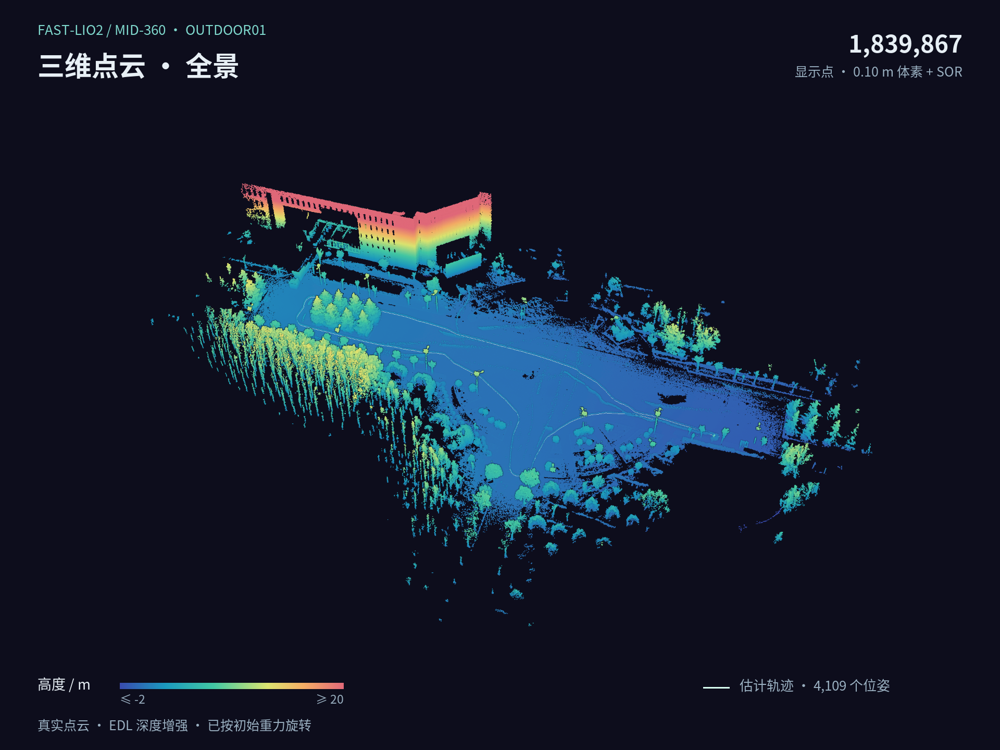
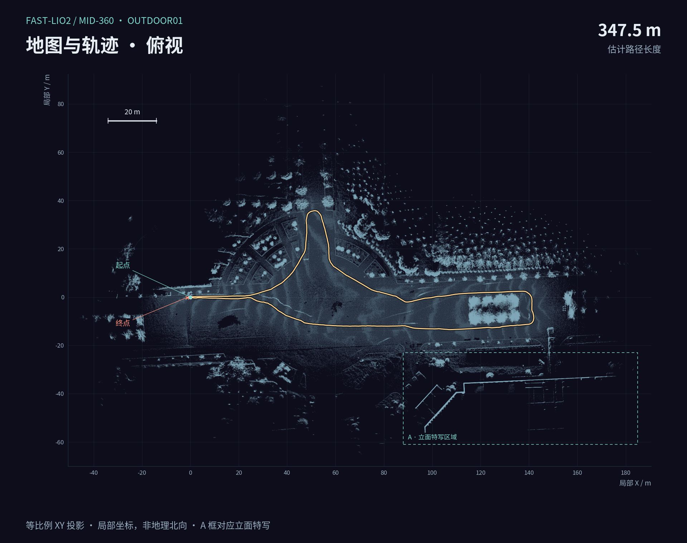
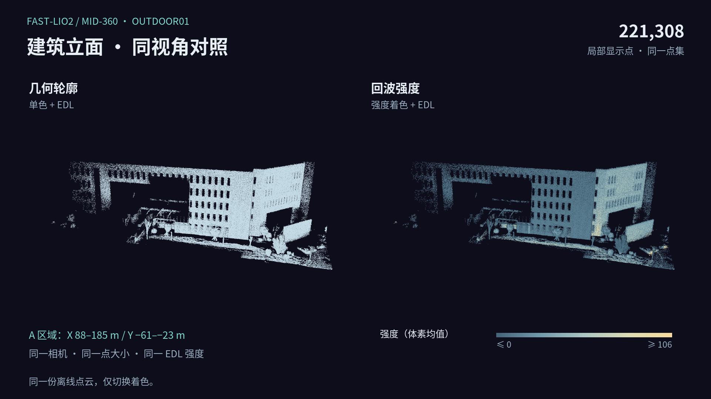

# Outdoor01 地图图集

[交互地图](https://AYANE225.github.io/FAST-Lio2-personal-research/viewer/) · [旋转 GIF](../figures/outdoor01_rotation.gif) · [回到首页](../README.md)

[](../figures/outdoor01_map_overview.png)

[](../figures/outdoor01_map_route.png)

[](../figures/outdoor01_map_facade.png)

同一份 Outdoor01 点云：0.10 m 体素 + SOR；轨迹为原估计结果，局部坐标按初始重力旋转。立面图仅切换着色；强度取体素内均值，保留设备数值尺度。这组图用于离线展示，定位误差与性能仍见 [实测结果](engineering_results.md)。

<details>
<summary>展开：从公开点块重绘</summary>

沿用 [动画说明](map_rotation.md) 中的 Python 3.11、Node 24、Playwright 1.58.2 和字体环境，安装当前 `requirements.txt`。在仓库根目录运行，输出目录使用新名称：

```bash
.venv/bin/python scripts/prepare_map_rotation.py \
  --output-dir output/gallery-data --workers 4

PLAYWRIGHT_MODULE="$PWD/output/rotation-tools/node_modules/playwright/index.mjs" \
node scripts/render_map_gallery.mjs \
  --data-dir output/gallery-data --output-dir output/gallery-render

.venv/bin/python scripts/plot_map_gallery.py \
  --data-dir output/gallery-data --render-dir output/gallery-render \
  --output-dir output/gallery-posters
```

[相机与区域配置](../configs/map_gallery.json) · [本次生成记录](../data/map_gallery.json) · [成品校验清单](../data/gallery_checksums.json)

导出时核对输入 SHA256、区域点数与 XYZI 哈希，并检查视锥范围及对照相机一致性。`map_gallery.json` 记录坐标范围、路径长度、相机、着色、依赖版本、字体和成品哈希。字体与浏览器版本会影响渲染像素；新导出不要求与发布图片逐字节一致。

</details>
